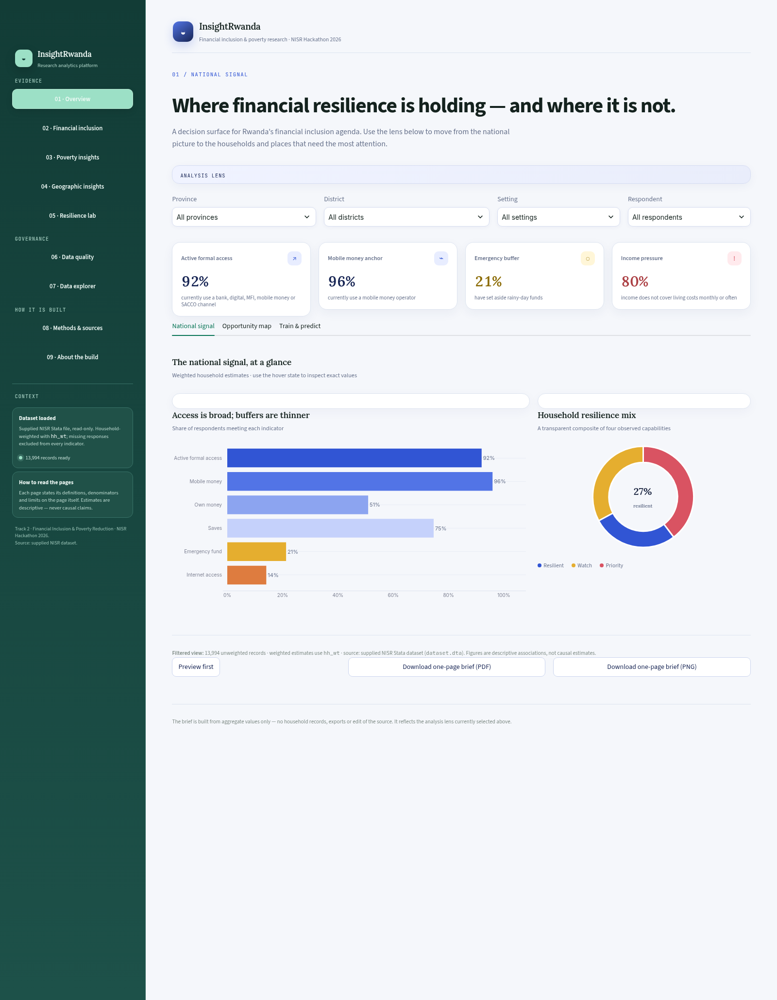
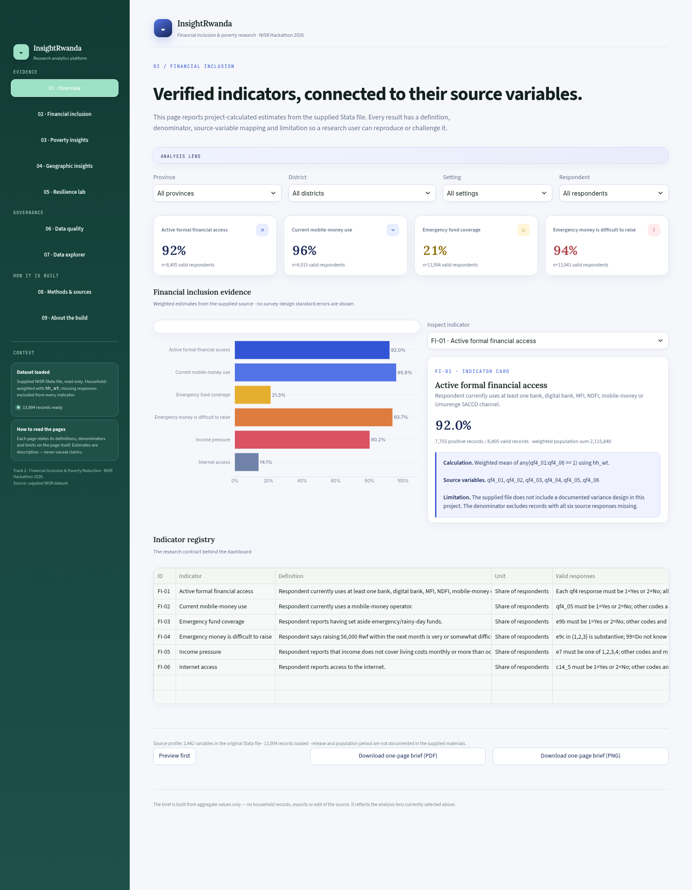
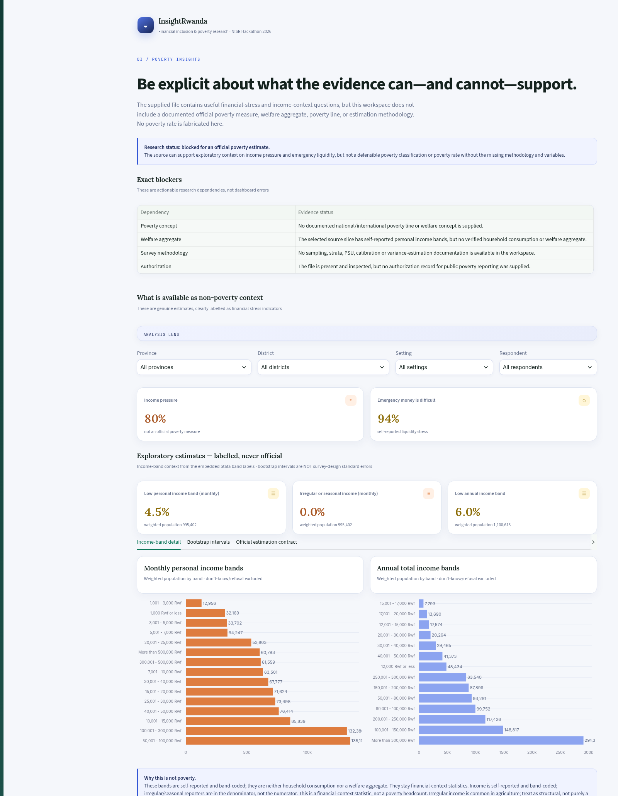
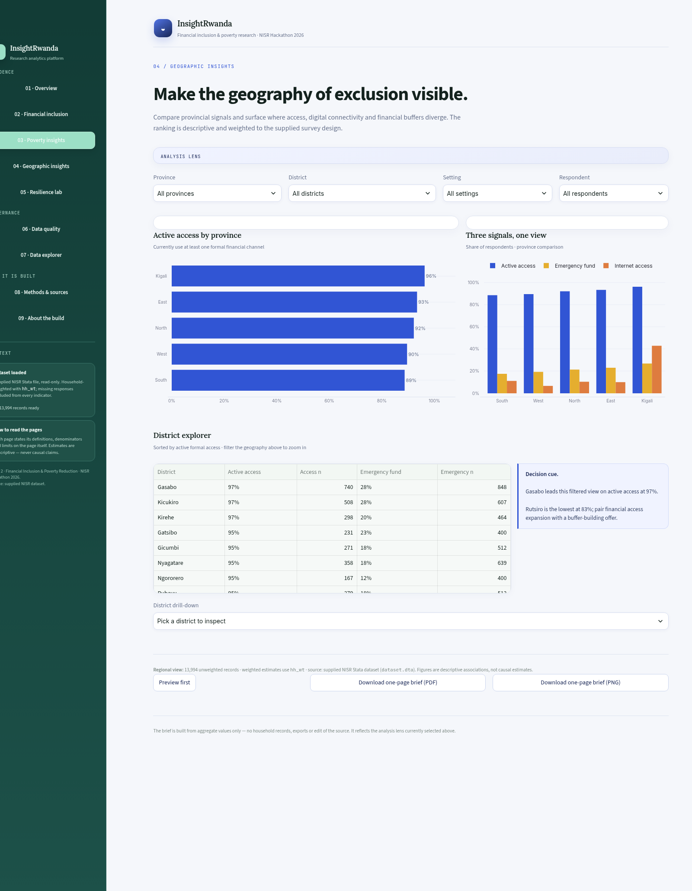
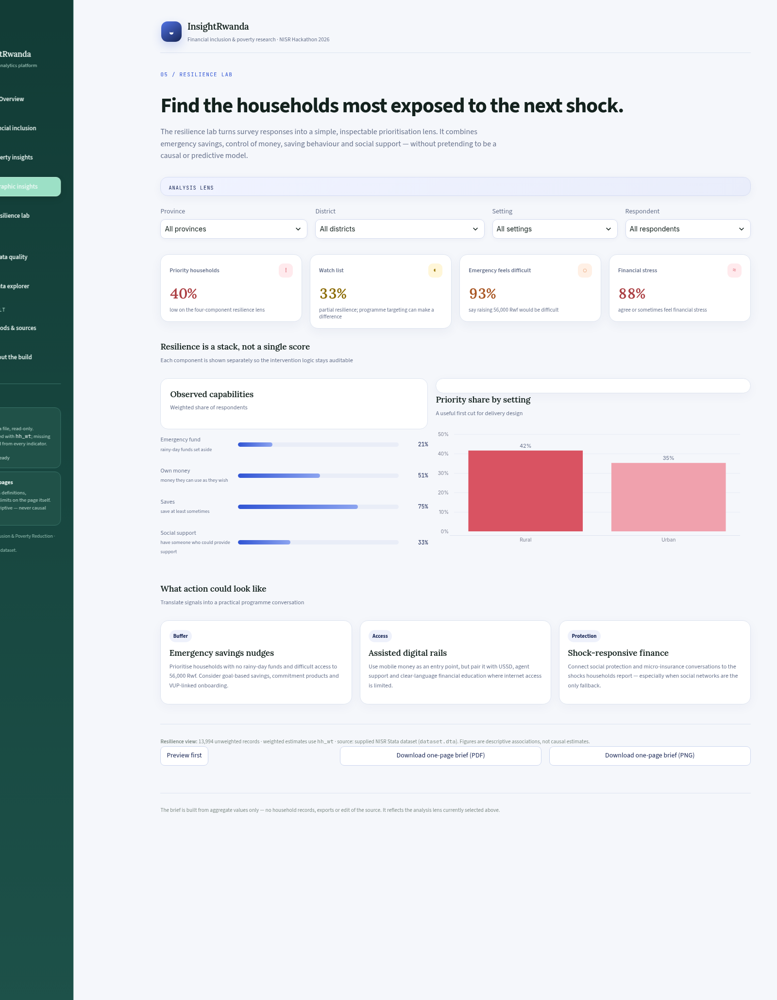
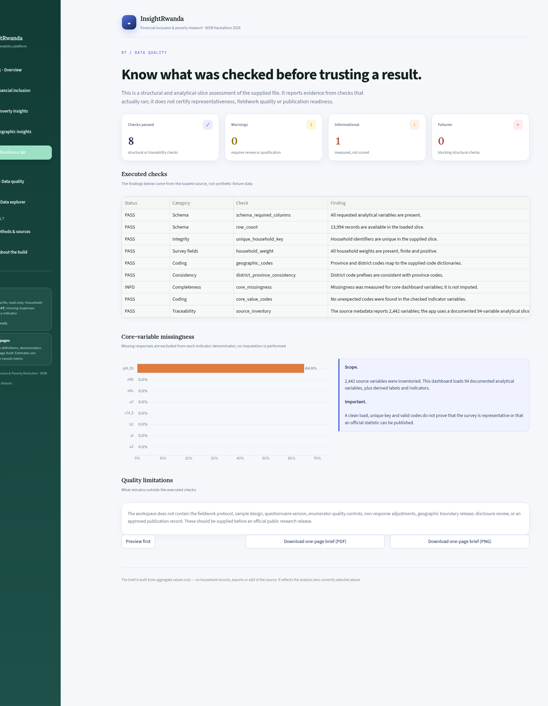
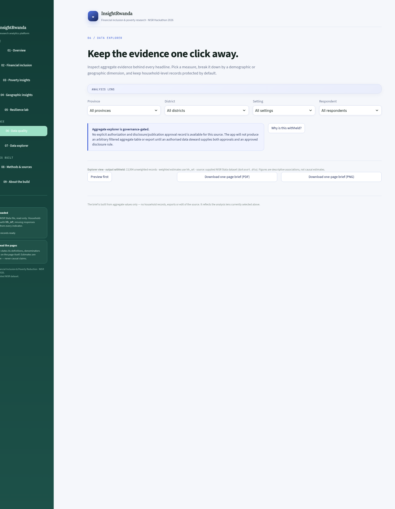
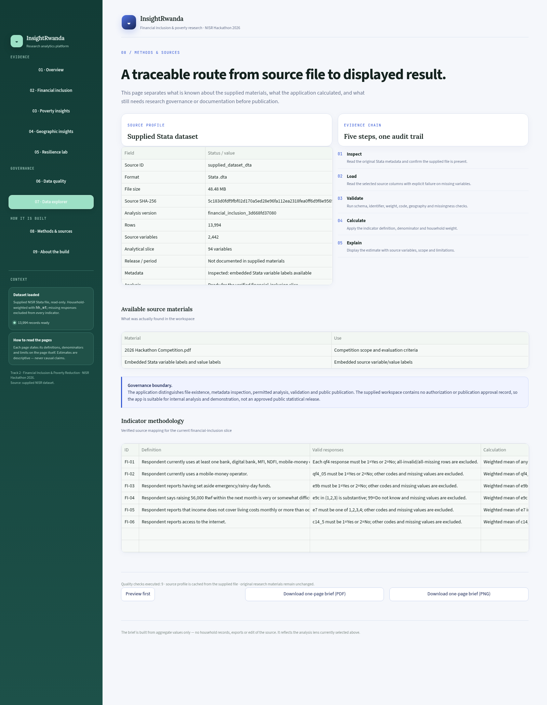
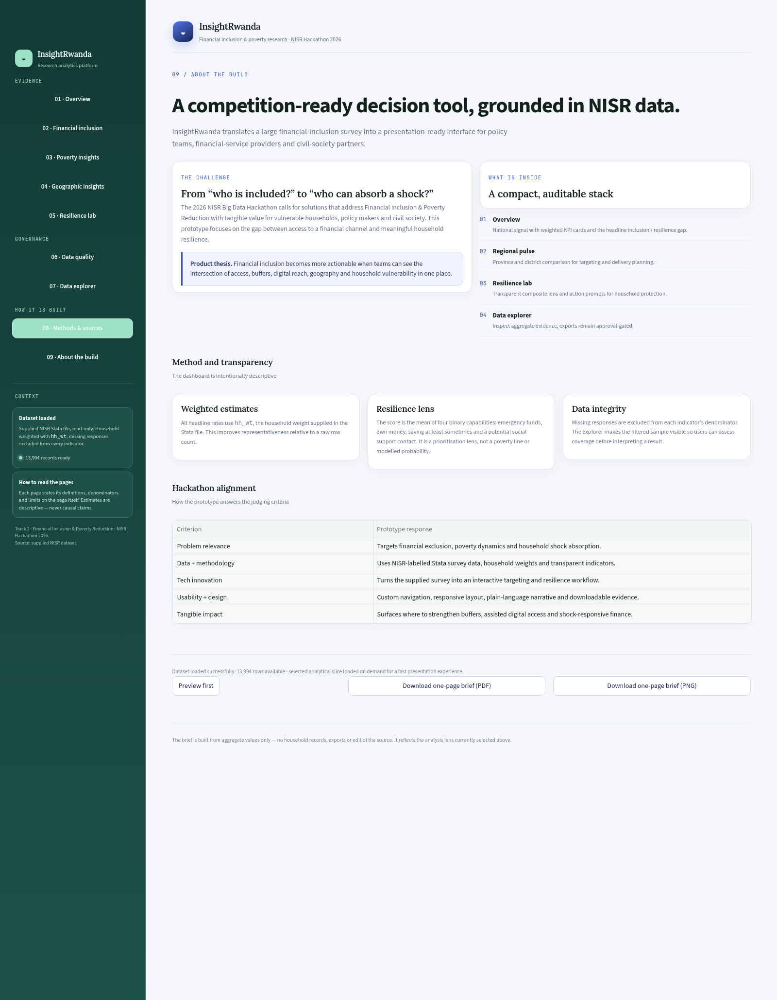

# InsightRwanda — Submission & Judge Guide

**Track 2 · Financial Inclusion & Poverty Reduction — NISR Big Data Hackathon 2026**

Read this before choosing between running the app and reviewing the screenshots — both are available, and both were produced from the same code.

*All screenshots below are real captures of the running application (headless Chrome via the DevTools protocol, marker-verified per page).*

**Take-away briefs:** every page also offers a one-page insight brief (PDF + PNG) via download buttons in the app, and committed copies live in `docs/briefs/` (`python scripts/build_briefs.py` regenerates them). Briefs are aggregate-only — no household records, no gated exports — with an explicit "what this brief cannot claim" panel, a "Preview first" modal, and three further governance modals (the poverty unlock contract, the explorer gate explainer). Motion is CSS-only with staggered card entrances, a KPI count-up, and a `prefers-reduced-motion` fallback for accessibility.

---

## 1. What to run locally

```bash
python -m venv .venv
source .venv/bin/activate        # Windows: .venv\Scripts\activate
pip install -r requirements.txt
streamlit run app.py
```

The app opens on **Overview** and loads the supplied Stata source directly from `data/dataset.dta` — read-only, nothing to configure, no API keys. The left rail is a grouped, numbered nav system (Evidence / Governance / How it is built) that matches each page's `0N /` eyebrow; the interface uses an Inter / Lora / JetBrains Mono webfont stack with offline fallbacks.

To re-verify before judging (optional, ~5 s):

```bash
python -m unittest discover -s tests        # 39/39 pass
python scripts/walkthrough_app.py           # headless render of all 9 pages
python scripts/browser_render_check.py      # real-Chrome render + marker check
```

## 2. The one-sentence thesis

**Account access is not resilience** — this dashboard shows where financial access is broad but shock-absorption is thin, and converts that gap into a district- and setting-level prioritisation lens.

## 3. Nine-page tour

### 01 · Overview — the national signal
Weighted KPIs (active formal access, mobile money, emergency buffer, income pressure) plus a headline candidate: *access is broad, buffers are thin*. The Train & predict tab fits an exploratory, explicitly-non-causal prioritisation model and evaluates it honestly: a holdout confusion matrix, five-fold cross-validated accuracy and AUC, per-fold stability, standardized-coefficient signs, and the caveat that it is descriptive — never an eligibility decision.



### 02 · Financial inclusion — the indicator registry
Six verified indicators (FI-01…FI-06), each with definition, valid-response rule, source variables, method and limitations — inspected down to numerator/denominator counts.



### 03 · Poverty insights — honesty as a feature
Reports the exact research blockers (no poverty line, no welfare aggregate, no variance methodology) instead of fabricating a poverty rate. Includes genuine non-poverty context metrics.



### 04 · Geographic insights — where to act
Province and district rankings of access, emergency funds and internet access, plus a district drill-down: pick any district to see active access, emergency buffer and internet against the national weighted mean (with deltas), the assessed case count, and the resilience Priority share split by urban/rural setting inside that district. A 60-second demo script mapped to the judging criteria is in `docs/DEMO.md`.



### 05 · Resilience lab — a transparent composite
The four observed capabilities behind the resilience band are shown separately, keeping the lens auditable rather than a black-box score.



### 06 · Data quality — checks that actually ran
Live structural checks on the real source (0 FAIL at the current audit) plus core-variable missingness — measured, never imputed.



### 07 · Data explorer — governance enforced in code
Withholds aggregate tables and exports until an authorization and publication-approval record exists in the source profile. The gate is tested software, not a disclaimer.



### 08 · Methods & sources — the evidence chain
Source profile (SHA-256, analysis-version fingerprint, row/variable inventory) and the five-step trail: Inspect → Load → Validate → Calculate → Explain.



### 09 · About the build — the product thesis
Why the access-vs-resilience framing is the actionable one, and how the prototype maps to each judging criterion.



## 4. What was verified

| Check | Result |
|---|---|
| Unit tests (real source + synthetic fixtures + estimation + briefs) | 39/39 OK |
| Headless page walkthrough (incl. filters, tabs) | 9/9 + 6/6 + tabs OK |
| Real-browser render (Chrome/CDP, DOM + pixel check) | PASSED |
| Data-quality checks on the source file | 0 FAIL |
| Screenshots in this guide | 9/9 pages, marker-verified |

## 5. Deliberate boundaries

No official poverty rate (methodology not supplied), no standard errors (no PSU/strata/variance metadata), no household-level exports (no authorization/disclosure rule supplied). The app states each of these on its own pages — those with the missing documents can unlock them in seconds, by design.
